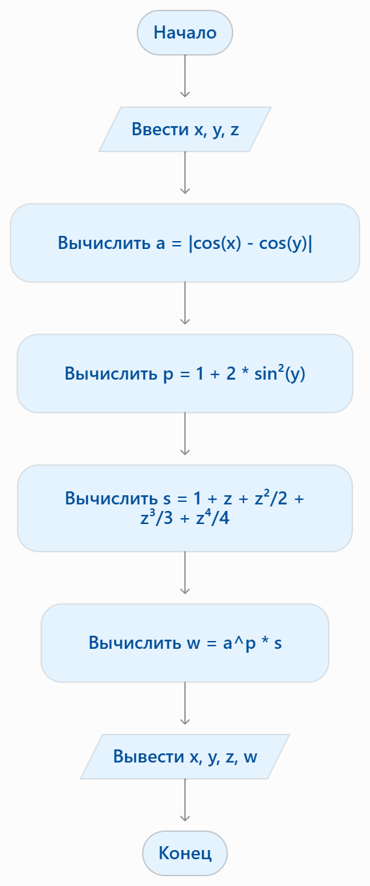

# Домашка к 5 лабе
### Вариант 4

Вывод:В ходе выполнения задания была разработана программа на языке C для вычисления заданного математического выражения. Результат проверен на контрольных значениях и соответствует примеру из таблицы.